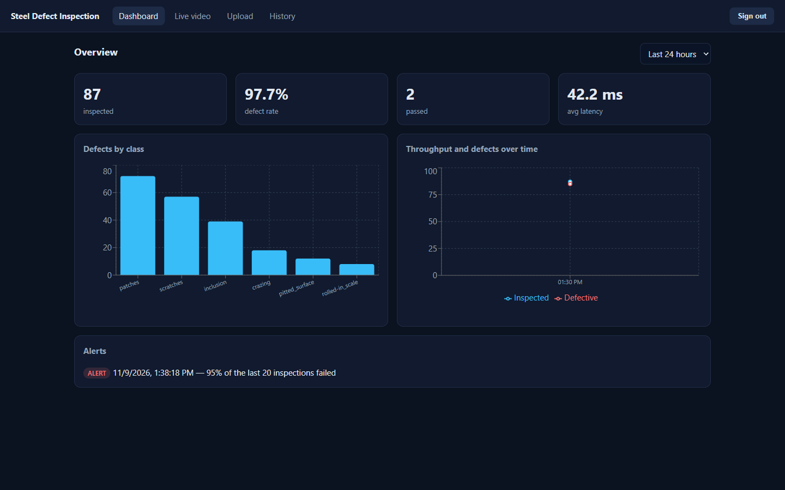
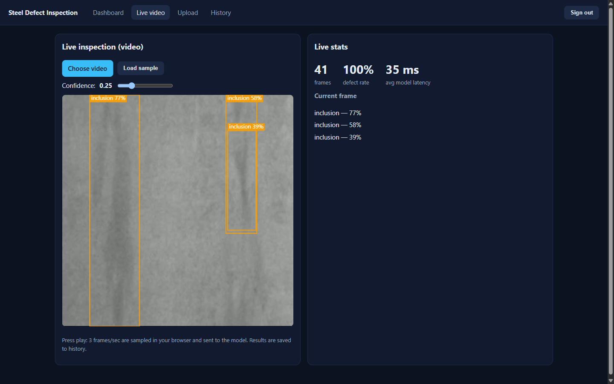
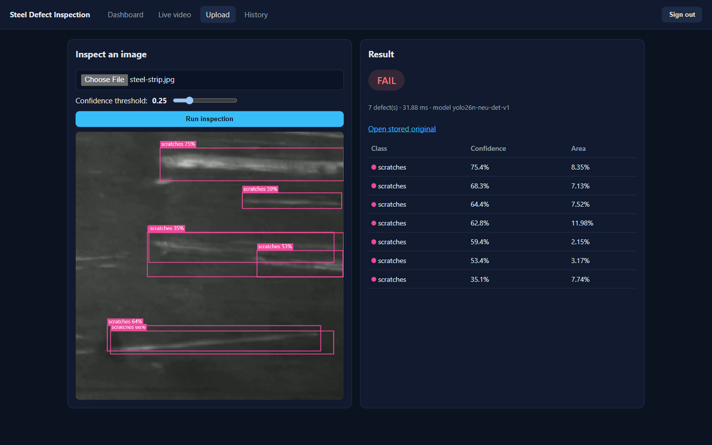
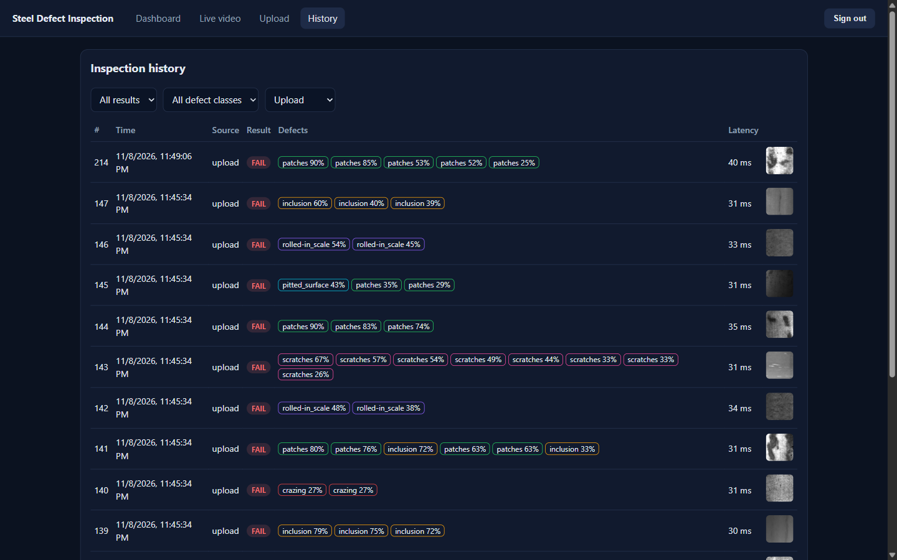

# Steel Surface Defect Inspection Platform

Real-time computer-vision quality inspection for steel surfaces. A YOLO26n model, trained on NEU-DET's 6 defect classes, runs behind a FastAPI service, a Node.js gateway handles auth, storage and alerts, and a React dashboard shows live video inspection, history and analytics.

```
React (Vite)  ──REST──►  Node/Express gateway  ──HTTP──►  FastAPI + ONNX Runtime (YOLO)
 upload · live video       JWT auth · uploads                 /predict  /health
 history · dashboard       alerts · stats                     CPU or CUDA
                                │
                           PostgreSQL (users, inspections, defects, alerts)
```

| Layer | Stack |
|---|---|
| Frontend | React 19, Vite 8, React Router 7, Recharts 3; served by nginx 1.30 |
| Gateway | Node 24, Express 5, `pg`, JWT, bcrypt, multer |
| Inference | Python 3.13, FastAPI, ONNX Runtime 1.31+, OpenCV, NumPy |
| Database | PostgreSQL 18 |
| Model / training | YOLO26n (shipped; YOLOv8n before it) via Ultralytics 8.4+, PyTorch + CUDA |
| Tooling | Docker Compose, GitHub Actions |

## Screenshots

Captured against the previous YOLOv8n model on NEU-DET validation images (not mock mode); the UI is unchanged with YOLO26n.


*Dashboard: KPIs, defects by class, throughput, and the defect-rate alert firing.*


*Live video: frames sampled in the browser at 3 fps, with detections drawn on the overlay (~35 ms per frame on CPU).*

| Upload | History |
|---|---|
|  |  |
| *Single-image inspection with verdict and detections table* | *Filterable history with per-defect chips* |

**Live video on the web:** the browser plays a video file, samples ~3 frames/sec onto a canvas, sends each to the gateway, and draws the returned boxes on an overlay. Nothing runs on the user's machine except the browser, so it deploys as-is.

**Defect classes:** crazing, inclusion, patches, pitted_surface, rolled-in_scale, scratches.

## Repo layout

| Folder | What it is |
|---|---|
| `ml/` | Data prep, training, ONNX export, latency benchmark, demo-video builder |
| `inference/` | FastAPI + ONNX Runtime service (has a `MOCK_MODE` for development) |
| `gateway/` | Express API: auth, `/api/inspect`, history, stats, alerts, Postgres schema |
| `frontend/` | React dashboard (Dashboard, Live video, Upload, History) |

Developer docs: [`docs/architecture.md`](docs/architecture.md) (request flow, schema, env vars), [`docs/project-status.md`](docs/project-status.md), [`docs/devlog.md`](docs/devlog.md) (daily log), [`CHANGELOG.md`](CHANGELOG.md). [`CLAUDE.md`](CLAUDE.md) holds the conventions for working on the repo with Claude Code.

## Quick start

The trained YOLO26n model (`inference/models/best.onnx`) is in the repo, so the whole stack runs with real detections out of the box:

```bash
docker compose up --build
# frontend http://localhost:5173   gateway http://localhost:4000   inference http://localhost:8000/docs
```

Register an account on the login screen, then try Upload and Live video ("Load sample" plays a clip built from NEU-DET validation images).

**Demo data:** to see the Dashboard and History with a week of history, seed mock inspections (about 240 over 7 days, a mix of passes and defects, one high-defect shift with an alert):

```bash
docker compose exec gateway npm run seed            # add --reset to replace earlier seeded rows
```

Then sign in as `SEED_EMAIL` / `SEED_PASSWORD` from `gateway/.env.example`. Seeded rows are tagged `model_version = 'seed-demo'`; the script refuses to run with `NODE_ENV=production`.

For UI work without the model, `MOCK_MODE=true docker compose up --build` returns random boxes instead. `MOCK_MODE` takes precedence over the model file. To keep overrides (`JWT_SECRET`, `MOCK_MODE`, `MODEL_VERSION`) between runs, copy `.env.example` to `.env`; Compose reads it automatically.

## Step 1: train the model (local GPU)

```bash
cd ml
python -m venv .venv && source .venv/bin/activate
pip install torch torchvision --index-url https://download.pytorch.org/whl/cu121   # match your CUDA version
pip install -r requirements.txt
python -c "import torch; print(torch.cuda.is_available())"                          # must print True
```

1. Download NEU-DET (search "NEU surface defect database" on Kaggle or the original NEU site) and unzip it.
2. Convert to YOLO format. This keeps the dataset's own split (1,440 train / 360 val, 60 val images per class) so results are comparable with published NEU-DET numbers; `--resplit` builds a new split stratified by class instead:
   ```bash
   python prepare_neu_det.py --src /path/to/NEU-DET --out data/neu-det
   ```
3. Train (start with the nano model, then compare against `yolov8s.pt` or `yolo26n.pt`; YOLO26 needs Ultralytics 8.4+):
   ```bash
   python train.py --data data/neu-det/data.yaml --model yolov8n.pt --epochs 100
   python train.py --data data/neu-det/data.yaml --model yolo26n.pt --epochs 100 --batch 8 --name neu-det-v1-26n
   ```
   Metrics land in `runs/<name>/metrics_summary.json` (mAP@0.5, mAP@0.5:0.95, precision, recall, per-class AP).
   To watch a run epoch by epoch against a baseline, serve `ml/` and open the monitor page:
   ```bash
   python -m http.server 8765 --bind 127.0.0.1    # from ml/
   # http://127.0.0.1:8765/monitor.html?run=neu-det-v1-26n&base=neu-det-v1&epochs=100
   ```
4. Export to ONNX and install into the inference service:
   ```bash
   python export_onnx.py --weights runs/neu-det-v1-26n/weights/best.pt --version yolo26n-neu-det-v1
   ```
   This overwrites the deployed `inference/models/`. To evaluate a candidate without touching it, add `--out-dir runs/<name>/onnx` and point `benchmark.py` / `parity_check.py` at it with `--model`/`--onnx` and `--labels`.

   The default export is the raw head `(1, 10, 8400)`, which the inference service runs NMS on. That is the path Ultralytics validates for this checkpoint, so it reproduces the reported mAP. `--end2end` exports YOLO26's NMS-free branch `(1, 300, 6)` instead; the service can read it, but it gives different detections and hasn't been validated, so don't ship it without re-running validation and `parity_check.py`. `--opset` defaults to whatever Ultralytics picks; the earlier YOLOv8n was exported with `--opset 12`.
5. Check the ONNX path matches PyTorch, then benchmark it:
   ```bash
   python parity_check.py --weights runs/neu-det-v1-26n/weights/best.pt
   python benchmark.py --images data/neu-det/images/val          # GPU
   python benchmark.py --images data/neu-det/images/val --cpu    # CPU (what Cloud Run runs)
   ```
6. Build the demo video the Live page plays:
   ```bash
   python make_demo_video.py --images data/neu-det/images/val --out demo_raw.mp4
   ffmpeg -y -i demo_raw.mp4 -c:v libx264 -preset veryfast -pix_fmt yuv420p -movflags +faststart ../frontend/public/sample.mp4
   ```

### Results

| Model | Params | mAP@0.5 | mAP@0.5:0.95 | Precision | Recall | CPU latency p50 / mean (ms) | GPU latency p50 / mean (ms) |
|---|---|---|---|---|---|---|---|
| **YOLO26n (shipped)** | 2.5 M | **0.739** | **0.404** | 0.739 | 0.662 | **31.1 / 30.9** | 11.0 / 11.5 |
| YOLOv8n (previous) | 3.1 M | 0.717 | 0.380 | 0.712 | 0.625 | 35.5 / 35.4 | 9.9 / 10.3 |
| YOLOv8s | 11.1 M | 0.733 | 0.380 | 0.624 | 0.704 | 79.8 / 81.1 † | 16.6 / 16.7 † |

Accuracy: NEU-DET validation split (360 images), `best.pt`, standard Ultralytics validation (NMS IoU 0.7). Precision and recall are at the confidence that maximises mean F1, not at the app's 0.25 default. All three models were trained with identical settings (640 px, batch 8, seed 42, up to 100 epochs). Latency: 200 validation images through the deployed ONNX path (letterbox + inference + NMS), measured with `ml/benchmark.py` (add `--cpu` for the CPU run) on a Ryzen 7 5800H / RTX 3050 Laptop GPU. YOLO26n and YOLOv8n were benchmarked back to back in the same session, twice in alternating order with the same result. † YOLOv8s comes from an earlier session in which YOLOv8n measured 29.0 ms p50 on CPU, so compare it by ratio (2.75× YOLOv8n), not absolute ms. `ml/parity_check.py` confirms the ONNX path reproduces the PyTorch detections (YOLO26n: 50/50 images match, max 0.06 px box difference; YOLOv8n: 20/20, max 0.10 px).

Per-class AP@0.5 (AP@0.5:0.95 in brackets):

| Class | YOLO26n | YOLOv8n | YOLOv8s | YOLO26n vs YOLOv8n |
|---|---|---|---|---|
| crazing | 0.496 (0.192) | 0.484 (0.205) | 0.497 (0.184) | +0.012 (−0.013) |
| inclusion | 0.827 (0.450) | 0.781 (0.422) | 0.821 (0.430) | +0.046 (+0.028) |
| patches | 0.913 (0.576) | 0.908 (0.595) | 0.905 (0.576) | +0.005 (−0.019) |
| pitted_surface | 0.786 (0.465) | 0.773 (0.413) | 0.802 (0.435) | +0.013 (+0.052) |
| rolled-in_scale | 0.584 (0.249) | 0.541 (0.217) | 0.558 (0.247) | +0.043 (+0.032) |
| scratches | 0.826 (0.491) | 0.816 (0.427) | 0.813 (0.410) | +0.010 (+0.064) |

Artifacts (metrics, training curves, F1/PR curves, confusion matrix): [`docs/results/yolo26n/`](docs/results/yolo26n/), [`docs/results/yolov8n/`](docs/results/yolov8n/), [`docs/results/yolov8s/`](docs/results/yolov8s/).

### Model choice: why YOLO26n ships

The rule set before training: replace YOLOv8n only if mAP@0.5 is at most 0.01 lower and CPU latency improves. YOLO26n clears both with room to spare.

- **More accurate on every class at IoU 0.5.** mAP@0.5 +0.022 and mAP@0.5:0.95 +0.024, with fewer parameters (2.5 M vs 3.1 M). It beats even YOLOv8s (3.5× larger YOLOv8n) on both metrics.
- **Better box placement overall.** AP@0.5:0.95 rises most on scratches (+0.064) and pitted_surface (+0.052), the opposite of YOLOv8s, which only traded precision for recall.
- **The weak classes improve, partly.** rolled-in_scale gains +0.043 AP@0.5; crazing only +0.012, and its AP@0.5:0.95 dips slightly (−0.013), as does patches (−0.019). crazing is still limited by loose NEU-DET boxes, so label tightening remains the next accuracy lever.
- **About 13% faster on CPU** (31 vs 36 ms p50), which is what Cloud Run runs. The vendor's claim of roughly 2× was not reproduced here: this deployment exports the raw head and runs the same NMS as YOLOv8n. On GPU it's about 1 ms slower, which doesn't matter for this deployment.
- **The NMS-free head isn't used yet.** This checkpoint validates through the standard head + NMS. Its end-to-end branch gives different detections (parity failed on 37/50 images), so it would need its own validation before it could ship.

YOLOv8n's files are kept in `ml/runs/backup-yolov8n-models/` if a rollback is needed.

#### Earlier decision: YOLOv8n over YOLOv8s

We trained YOLOv8s (3.5× the parameters) to test whether model capacity was the bottleneck. It wasn't, so the smaller model shipped. (Numbers in this section are from that session, when YOLOv8n measured 29.0 ms CPU p50.)

- **The accuracy gain is small.** mAP@0.5 rises by only +0.016, below the 0.03 we set in advance as the minimum worth paying for. mAP@0.5:0.95 is unchanged (0.380 vs 0.380).
- **It finds more defects but doesn't localise them better.** YOLOv8s trades precision for recall (P 0.712 → 0.624, R 0.625 → 0.704), while box quality is flat. For inspection, a box that lands in the wrong place on the strip is not an improvement.
- **The recall gain comes mostly from a different operating point.** F1 from the reported P/R is 0.666 for YOLOv8n vs 0.661 for YOLOv8s. The apparent recall jump comes from where Ultralytics happens to report P/R on each model's curve. YOLOv8n reaches the same recall (0.70) by lowering its confidence threshold, and it already does at the app's default of 0.25: P 0.605 / R 0.702. Compared at that same 0.70 recall, YOLOv8s is only slightly more precise (0.631 vs 0.608, F1 0.652 vs 0.644). That small edge, which matches the +0.016 mAP, isn't worth 80 ms instead of 29 ms per image.
- **The weak classes stay weak.** crazing (+0.013) and rolled-in_scale (+0.017) barely move. crazing's AP@0.5:0.95 even drops. This fits the earlier diagnosis that these classes are limited by loose NEU-DET boxes, not by model size, so the next accuracy gain should come from tightening those labels.
- **It costs 2.75× the CPU time.** CPU p50 is 79.8 ms vs 29.0 ms. Cloud Run's 2 vCPUs should be about 2–3× slower than this laptop, which would put YOLOv8s around 160–240 ms per frame. That uses most of the Live page's ~333 ms per-frame budget, for a model that is no better at placing boxes.

**Expected latency on Cloud Run:** 2 vCPUs is far fewer cores than the 8-core benchmark machine, and ONNX Runtime scales with cores, so budget roughly **80–120 ms** per frame there for YOLO26n instead of ~31 ms (an estimate, not yet measured). The Live page is designed for this: it sends at most one frame at a time and skips ticks while a request is in flight instead of queueing them. It keeps the full 3 fps while a round trip (gateway + inference + DB) stays under ~333 ms, and drops to ~1.5 fps instead of falling behind when it doesn't.

### Confidence threshold

The default confidence threshold is **0.25** (Upload and Live sliders, and the gateway fallback).

For YOLO26n:

- Peak F1 across all classes is **0.69 at 0.31**, and the curve stays within 0.01 of that from **0.27 to 0.38**. At 0.25 it's **0.68** (P 0.674 / R 0.696), so the default costs about 0.013 F1 in exchange for recall.
- `crazing` peaks at **0.14** and loses recall above it; `rolled-in_scale` now peaks at 0.31. `inclusion`, `patches` and `scratches` peak around 0.52.
- 0.25 stays the default to favour recall: in inspection, a missed defect costs more than a false alarm. (It was chosen for YOLOv8n, whose curve was flat from 0.22 to 0.40.)

Source: [`docs/results/yolo26n/BoxF1_curve.png`](docs/results/yolo26n/BoxF1_curve.png) and `f1` in [`metrics_summary.json`](docs/results/yolo26n/metrics_summary.json) (YOLO26n, `best.pt`, NEU-DET validation split).

## Step 2: run locally without Docker

```bash
# 1. Postgres
docker run -d --name inspection-db -e POSTGRES_PASSWORD=postgres -e POSTGRES_DB=inspection -p 5432:5432 postgres:18-alpine

# 2. Inference (uses inference/models/best.onnx, or MOCK_MODE=true)
cd inference && pip install -r requirements.txt && uvicorn app.main:app --port 8000

# 3. Gateway
cd gateway && cp .env.example .env && npm install && npm run dev

# 4. Frontend
cd frontend && cp .env.example .env && npm install && npm run dev
```

The gateway creates its tables automatically on startup (`gateway/db/init.sql`).

## API (gateway)

| Method | Path | Notes |
|---|---|---|
| POST | `/api/auth/register`, `/api/auth/login` | Returns a JWT (12 h) |
| POST | `/api/inspect` | multipart: `image`, `conf` (0.05–0.95), `source` (`upload`/`video`) |
| GET | `/api/inspections` | Filters: `status`, `class`, `source`; paging: `limit`, `offset` |
| GET | `/api/stats?days=7` | Totals, defects by class, timeline |
| GET | `/api/alerts` | Recent alerts |
| GET | `/api/health` | DB check |

**Alert rule:** when at least `ALERT_THRESHOLD` (default 50%) of the last `ALERT_WINDOW` (default 20) inspections failed, an alert is stored and returned with the inspect response (60 s cooldown).

## Step 3: deploy

Free tiers sleep after inactivity, so the first request can be slow (cold start). Mention it in your demo notes.

1. **Database:** create a free Postgres on [Neon](https://neon.tech) or Supabase. Copy the connection string.
2. **Inference** (Google Cloud Run; commit `inference/models/best.onnx` first, the nano model is small):
   ```bash
   gcloud run deploy inspection-inference --source inference --region asia-south1 \
     --memory 1Gi --cpu 2 --allow-unauthenticated \
     --set-env-vars MODEL_VERSION=yolo26n-neu-det-v1
   ```
   Better: deploy it as private (no `--allow-unauthenticated`) and let only the gateway call it.
3. **Gateway** (Cloud Run, Render or Railway):
   ```bash
   gcloud run deploy inspection-gateway --source gateway --region asia-south1 --allow-unauthenticated \
     --set-env-vars NODE_ENV=production,DB_SSL=true,JWT_SECRET=<long-random>,\
   DATABASE_URL=<neon-url>,INFERENCE_URL=<inference-url>,CORS_ORIGINS=<frontend-url>
   ```
   `UPLOAD_DIR` is local disk, which is ephemeral on Cloud Run. Uploaded originals disappear on restart; video frames are never stored. Move uploads to GCS or Cloudflare R2 when you improve this.
4. **Frontend** (Vercel or Netlify): import the repo, set the root to `frontend`, and add `VITE_API_URL=<gateway-url>`. `frontend/vercel.json` handles client-side routing. Add the frontend URL to the gateway's `CORS_ORIGINS`.
5. `frontend/public/sample.mp4` (committed, built from NEU-DET validation images) ships with the build, so "Load sample" works for visitors.

## Tests and CI

```bash
cd inference && pytest        # letterbox, NMS, post-processing for YOLOv8 and YOLO26 outputs, API (mock mode)
cd gateway && npm test        # alert rule, async error handling, auth guard, 404
cd frontend && npm run build
```

GitHub Actions (`.github/workflows/ci.yml`) runs all three (Python 3.13, Node 24) and a `docker compose build`.

## Roadmap (improvements for later)

- Human review queue: confirm or reject detections and export corrections as retraining data (`defects.reviewed` / `review_label` columns already exist)
- WebSocket push for alerts and a true stream endpoint
- Email or Slack alert delivery
- Anomaly-detection mode (PatchCore via `anomalib`) for unseen defect types
- Object storage for uploads, model registry and versioned rollouts, Prometheus metrics
- Model comparison page (YOLOv8n vs YOLOv8s vs YOLO26n)
- Per-class confidence thresholds instead of one global value: low for `crazing` (YOLO26n's F1 peaks at 0.14), around 0.5 for `inclusion`, `patches` and `scratches`
